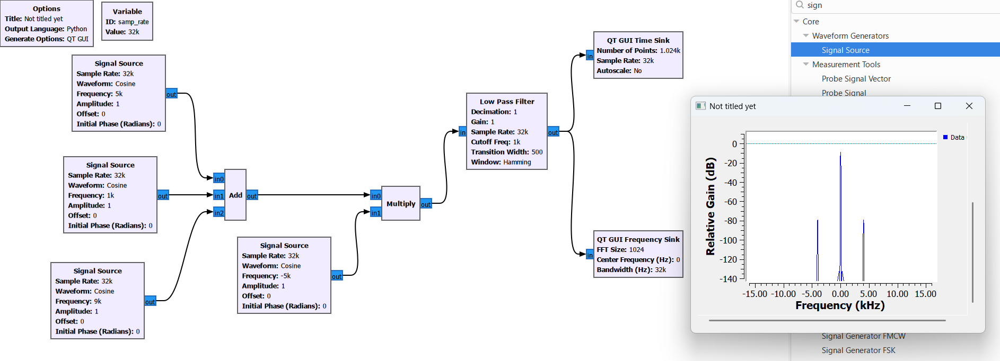
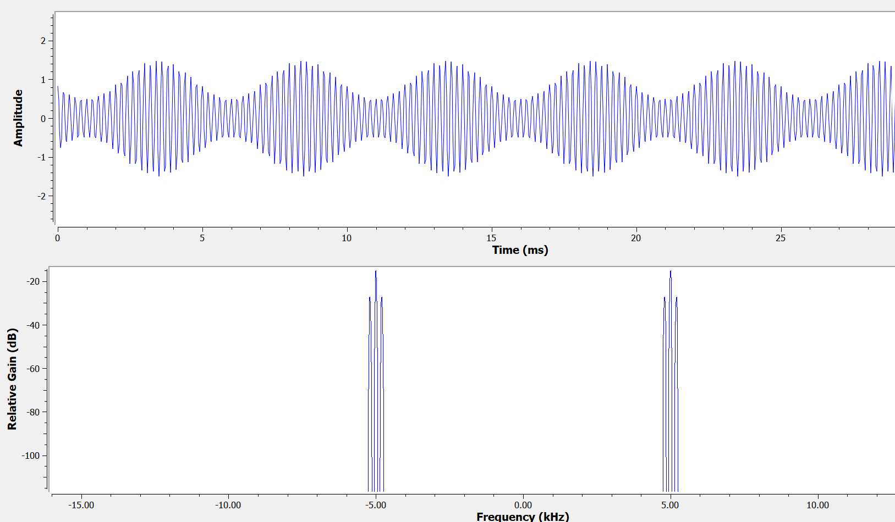
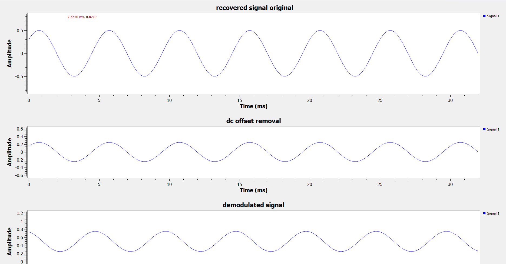
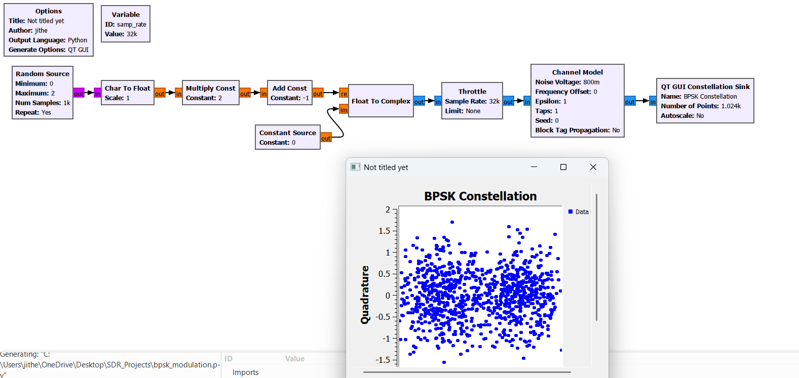

# SDR and GNU Radio Receiver Experiments

## Overview
This repository documents my hands-on learning and experiments with Software Defined Radio (SDR) using GNU Radio Companion.

The project focuses on digital signal processing techniques used in communication receivers, including frequency conversion, filtering, and signal analysis.

## Tools
- GNU Radio Companion
- Python
- QT GUI Frequency Sink
- Complex signal sources and FIR filters

## Experiment 1: Digital Downconversion

**Objective:** Demonstrate frequency shifting using complex multiplication and signal selection using a low-pass filter.

### Flowgraph

Two complex signal sources are connected to a Multiply block, followed by a Low Pass Filter and QT GUI Frequency Sink.

### Configuration
- Sample rate: 32 kS/s
- Input signal frequency: +5 kHz
- Local oscillator: −5 kHz or −3 kHz
- Low-pass filter cutoff: 1 kHz
- Transition width: 500 Hz
- Filter window: Hamming

### Experimental Results

| Test | Output Frequency | Measured Spectrum Level |
|---|---|---|
| Mixer output without LPF (LO = −3 kHz) | +2 kHz | −9.5 dB |
| Mixer output with LPF (LO = −3 kHz) | +2 kHz | −68 dB |
| Mixer output with LPF (LO = −5 kHz) | 0 Hz | −7.02 dB |

The low-pass filter suppressed the +2 kHz spectral peak by approximately **58.5 dB**, based on measurements with the QT GUI Frequency Sink.

These values are relative spectral measurements, not calibrated RF power readings.

## Key Learnings
- Complex multiplication shifts signal frequencies.
- A digital mixer can move a selected signal to baseband.
- Low-pass filtering can suppress signals outside the desired passband.
- Digital downconversion is a fundamental operation in SDR receivers.

## Experiment 2: Multi-Signal Receiver and Channel Selection

### Objective
Simulate the reception of three complex signals and select one desired signal using digital downconversion and low-pass filtering.

### GNU Radio Flowgraph
Three complex Signal Source blocks are combined using an Add block. The combined signal is multiplied by a complex local oscillator and passed through a Low Pass Filter before spectral analysis.

**Signal processing chain:**

`3 Signal Sources → Add → Multiply (LO) → Low Pass Filter → QT GUI Frequency Sink`

### Configuration
- Sample rate: 32 kS/s
- Wanted signal: +5 kHz
- Unwanted signals: +1 kHz and +9 kHz
- Local oscillator: −5 kHz
- Low-pass filter cutoff: 1 kHz
- Transition width: 500 Hz
- Filter window: Hamming

### Experimental Results

| Input Signal | Frequency After Mixing | Measured Spectrum Level | Result |
|---|---|---|---|
| +1 kHz | −4 kHz | −80.12 dB | Suppressed |
| +5 kHz | 0 kHz | −8.2 dB | Passed |
| +9 kHz | +4 kHz | −80.12 dB | Suppressed |

### Analysis

The complex mixer shifted the desired +5 kHz signal to 0 Hz while shifting the two unwanted signals to −4 kHz and +4 kHz.

The low-pass filter preserved the desired signal near 0 Hz and strongly suppressed the unwanted signals.

The measured separation between the wanted peak and each unwanted peak was:

**−8.2 − (−80.12) = 71.92 dB**

This is a relative spectral peak separation measured using the GNU Radio QT GUI Frequency Sink, not a calibrated receiver rejection measurement.

### Key Learnings
- Combining multiple complex signals to simulate simultaneous reception
- Digital frequency shifting using a complex local oscillator
- Channel selection using a low-pass filter
- Spectral analysis and measurement of unwanted-signal suppression

### Experimental Flowgraph and Output

## Experiment 3: Amplitude Modulation (AM)

### Objective
To implement a conventional AM transmitter in GNU Radio and analyze the modulated signal in the time and frequency domains.

### GNU Radio Implementation
The AM transmitter was developed using:
- Two Signal Source blocks (Float)
- Add Const block
- Multiply block
- QT GUI Time Sink
- QT GUI Frequency Sink

### Simulation Parameters
| Parameter | Value |
|---|---|
| Sampling rate | 32 kS/s |
| Carrier frequency | 5 kHz |
| Message frequency | 200 Hz |
| Message amplitude | 0.5 |
| Carrier amplitude | 1 |
| DC offset | 1 |
| Modulation index | 50% |

### AM Signal Equation

`s(t) = [1 + 0.5 cos(2π × 200t)] cos(2π × 5000t)`

### Experimental Results
**Time Domain:** The carrier oscillates at 5 kHz while its amplitude envelope follows the 200 Hz message. The envelope magnitude varies between 0.5 and 1.5.

**Frequency Domain:** Three positive-frequency components were observed:

| Component | Frequency |
|---|---|
| Lower sideband (LSB) | 4.8 kHz |
| Carrier | 5.0 kHz |
| Upper sideband (USB) | 5.2 kHz |

Corresponding negative-frequency components appear because the AM signal is real-valued.

### AM Waveform and Frequency Spectrum

### Key Learnings
- Generated a conventional AM signal using GNU Radio.
- Observed the message envelope in the time domain.
- Identified the carrier and two sidebands in the frequency spectrum.
- Understood the relationship between message frequency and sideband spacing.
- Learned how the modulation index affects the amplitude envelope.

## Experiment 4: Coherent AM Demodulation

### Objective
To implement a coherent AM receiver in GNU Radio and recover the original 200 Hz message from a 5 kHz amplitude-modulated carrier.

### GNU Radio Implementation
The experiment extends the AM transmitter developed in Experiment 3. The receiver uses a synchronized 5 kHz local oscillator, a Multiply block, a low-pass filter, DC offset correction, and amplitude scaling.

**Receiver processing chain:**

`AM signal → Multiply with 5 kHz LO → Low Pass Filter → Add Const (-0.5) → Multiply Const (2) → Recovered Message`

### Simulation Parameters

| Parameter | Value |
|---|---|
| Sample rate | 32 kS/s |
| Carrier frequency | 5 kHz |
| Message frequency | 200 Hz |
| Original message amplitude | 0.5 |
| Modulation index | 50% |
| Receiver LO frequency | 5 kHz |
| Low-pass filter cutoff | 1 kHz |
| Filter transition width | 500 Hz |
| Filter window | Hamming |
| DC offset correction | -0.5 |
| Amplitude scaling | 2 |

### Demodulation Principle
The transmitted AM signal is:

`s(t) = [1 + 0.5 cos(2π × 200t)] cos(2π × 5000t)`

Multiplying the AM signal by a synchronized 5 kHz cosine and applying a low-pass filter gives approximately:

`y(t) = 0.5 + 0.25 cos(2π × 200t)`

Removing the DC offset and restoring the amplitude gives:

`m_recovered(t) = 2[y(t) - 0.5] = 0.5 cos(2π × 200t)`

The low-pass filter introduces a time delay, so the recovered waveform may be phase-shifted relative to the original message.

### Experimental Results
- Successfully recovered the original 200 Hz message frequency.
- Observed a demodulated waveform with a DC offset of approximately 0.5 and an amplitude of approximately 0.25.
- Removed the DC offset using Add Const (-0.5).
- Restored the message amplitude using Multiply Const (2).
- Obtained a recovered cosine waveform with an amplitude of approximately 0.5.

### GNU Radio Flowgraph

### Demodulation Results

### Key Learnings
- Implemented coherent AM demodulation using GNU Radio.
- Understood how multiplication with a synchronized local oscillator shifts signal components to baseband.
- Used a low-pass filter to remove high-frequency mixing products.
- Removed DC offset and restored the original message amplitude.
- Observed the effect of FIR filter delay on the recovered waveform.

## Experiment 5: FM Modulation and Spectrum Analysis

### Objective
Generate a frequency-modulated (FM) signal using GNU Radio and analyze its frequency spectrum.

### GNU Radio Configuration

| Parameter | Value |
|---|---|
| Sample Rate | 32 kS/s |
| Message Frequency | 200 Hz |
| Message Amplitude | 1 |
| FM Modulator Sensitivity | 0.5 rad/sample |
| FFT Size | 2048 |
| Modulation Type | Frequency Modulation (FM) |

### Theory

In frequency modulation, the instantaneous frequency of the carrier changes according to the amplitude of the message signal.

The message signal is:

\[
m(t)=\cos(2\pi \cdot 200t)
\]

The frequency deviation is calculated as:

\[
\Delta f=\frac{k f_s}{2\pi}
\]

where:
- \(k=0.5\) is the FM modulator sensitivity.
- \(f_s=32000\) samples/second.

Therefore:

\[
\Delta f \approx 2546\text{ Hz}
\]

Using Carson's rule:

\[
BW\approx2(\Delta f+f_m)
\]

\[
BW\approx2(2546+200)=5492\text{ Hz}
\]

The estimated FM bandwidth is approximately **5.5 kHz**.

### FM Spectrum

### Observations

- The FM spectrum contains multiple sidebands around the baseband center frequency.
- Sideband spacing is approximately 200 Hz.
- Most of the signal energy is concentrated within approximately ±3 kHz.
- Increasing the FFT size from 1024 to 2048 improved frequency-bin spacing from 31.25 Hz to 15.625 Hz.

### Result

Successfully generated an FM signal and analyzed its spectrum using the GNU Radio QT GUI Frequency Sink.

---

## Experiment 6: FM Demodulation Using Quadrature Demod

### Objective

Recover the original 200 Hz message from a frequency-modulated signal using quadrature demodulation.

### GNU Radio Configuration

| Parameter | Value |
|---|---|
| Sample Rate | 32 kS/s |
| Message Frequency | 200 Hz |
| Message Amplitude | 1 |
| FM Modulator Sensitivity | 0.5 |
| Quadrature Demod Gain | 2 |
| Time Sink Inputs | 2 |

### Theory

The FM modulator converts the message signal into instantaneous frequency variations.

The Quadrature Demod block estimates the phase difference between consecutive complex samples to recover the original message.

The demodulator gain is selected as the inverse of the modulator sensitivity:

\[
G=\frac{1}{0.5}=2
\]

Ideally, the recovered message is approximately:

\[
\hat m(t)\approx\cos(2\pi\cdot200t)
\]

### GNU Radio Flowgraph

### Demodulated Signal

### Observations

- The original and recovered messages have approximately the same frequency of 200 Hz.
- The recovered amplitude is approximately ±1.
- The waveforms overlap closely in the QT GUI Time Sink.
- Quadrature demodulation successfully recovered the original message without requiring a separate synchronized carrier oscillator.

### Result

Successfully implemented FM modulation and quadrature demodulation in GNU Radio, recovering the original message signal with minimal visible distortion.

## Experiment 7: BPSK Modulation and Constellation Analysis

### Objective

Implement Binary Phase Shift Keying (BPSK) modulation using GNU Radio Companion and visualize the ideal BPSK constellation.

### GNU Radio Flowgraph (.grc)

**GNU Radio project file:** [bpsk_modulation.grc](bpsk_modulation.grc)

### Flowgraph and Output Screenshot

### Configuration

| Parameter | Value |
|---|---|
| Sample Rate | 32 kS/s |
| Random Source | Binary values 0 and 1 |
| Random Samples | 1000, repeated |
| Char to Float Scale | 1 |
| Multiply Const | 2 |
| Add Const | -1 |
| Quadrature Component (Q) | 0 |
| Modulation | BPSK |

### Theory

Binary Phase Shift Keying (BPSK) represents digital information using two signal phases separated by 180 degrees.

The binary-to-symbol mapping is:

**s = 2b − 1**

where `b` represents the transmitted bit.

| Input Bit | BPSK Symbol | Phase |
|---|---|---|
| 0 | -1 | 180° |
| 1 | +1 | 0° |

The complex symbols are:

**s ∈ {-1 + j0, +1 + j0}**

### Flowgraph Explanation

1. **Random Source:** Generates binary values 0 and 1.
2. **Char to Float:** Converts the generated integer values into floating-point samples.
3. **Multiply Const (2):** Multiplies each sample by 2.
4. **Add Const (-1):** Converts binary values into BPSK symbols -1 and +1.
5. **Float to Complex:** Places the BPSK symbols on the in-phase (I) axis, with Q = 0.
6. **Throttle:** Controls the simulation sample rate.
7. **QT GUI Constellation Sink:** Displays the BPSK symbols on the complex plane.

### Observations

- Two distinct constellation points appear at (-1, 0) and (+1, 0).
- The quadrature component remains zero.
- The constellation demonstrates the two possible BPSK symbol states.
- The symbols are separated by 180 degrees in phase.

### Result

Successfully implemented BPSK modulation and visualized the ideal constellation in GNU Radio.

**Files:**

- [bpsk_modulation.grc](bpsk_modulation.grc)
- [BPSK const and flowgraph.png](BPSK%20const%20and%20flowgraph.png)

---

## Experiment 8: BPSK Modulation Through an AWGN Channel

### Objective

Investigate the effect of additive white Gaussian noise (AWGN) on BPSK signals and observe how increasing noise affects the received constellation.

### GNU Radio Flowgraph (.grc)

**GNU Radio project file:** [bpsk_awgn_modulation.grc](bpsk_awgn_modulation.grc)

The Channel Model block is inserted between the BPSK transmitter and the Constellation Sink.

### Configuration

| Parameter | Value |
|---|---|
| Sample Rate | 32 kS/s |
| Modulation | BPSK |
| Channel Model | AWGN |
| Noise Voltage — Test 1 | 0.2 |
| Noise Voltage — Test 2 | 0.8 |
| Frequency Offset | 0 |
| Epsilon | 1.0 |
| Channel Taps | [1.0] |

### Theory

A received BPSK signal affected by AWGN can be represented as:

**r = s + n**

where:

- `r` = received complex signal
- `s` = transmitted BPSK symbol
- `n` = additive complex Gaussian noise

For the selected BPSK mapping, the receiver determines the transmitted bit using the in-phase component:

- **I ≥ 0 → Bit 1**
- **I < 0 → Bit 0**

When noise moves a received symbol across the decision boundary at I = 0, a bit detection error may occur.

### Test 1: Noise Voltage = 0.2

#### GNU Radio Flowgraph and Noisy BPSK Constellation

**Observations:**

- The constellation displays two compact clusters around the ideal BPSK points.
- Noise introduces variations in both the I and Q components.
- The two symbol clusters remain clearly separated.
- The expected probability of incorrect bit detection is relatively low.

### Test 2: Noise Voltage = 0.8

#### GNU Radio Output at Higher Noise

**Observations:**

- The received constellation becomes significantly more spread out.
- The two clusters overlap more strongly.
- Some received symbols cross the decision boundary.
- The expected bit error probability increases.

### Comparison of Noise Levels

| Observation | Noise Voltage = 0.2 | Noise Voltage = 0.8 |
|---|---|---|
| Constellation Spread | Small | Large |
| Cluster Separation | Clear | Significant overlap |
| Expected Bit Error Probability | Lower | Higher |
| Signal Quality | Better | Worse |

### Practical Relevance

BPSK is used in digital communication systems, including satellite communication applications, because of its relatively simple detection process and robustness to noise.

This experiment demonstrates how channel noise affects symbol detection and provides a foundation for receiver design and Bit Error Rate (BER) analysis.

### Result

Successfully simulated BPSK transmission through an AWGN channel and observed the effect of increasing noise on the received constellation.

The actual BER has not yet been measured. This will be addressed in a subsequent BPSK receiver experiment.

**Files:**

- [bpsk_awgn_modulation.grc](bpsk_awgn_modulation.grc)
- [noisy BPSK constellation.png](noisy%20BPSK%20constellation.png)
- [noisebpsk.8.png](noisebpsk.8.png)

## Project Status
Ongoing learning and experimental development.
